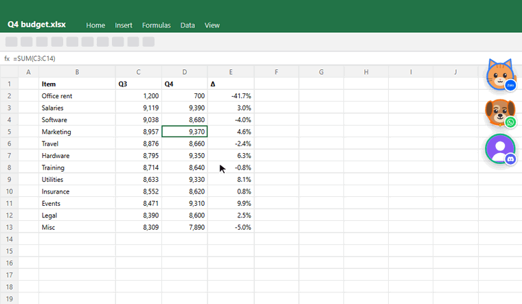

<div align="center">


# Chatlings

**Bong bóng chat nổi trên máy tính.** Zalo, Messenger, WhatsApp, Telegram, Discord… thành các bong bóng nằm ở mép màn hình như trên điện thoại. Đang làm Excel, bấm bong bóng là chat, bấm ra ngoài là quay lại làm việc.

Nhiều tài khoản cùng lúc · bong bóng mèo & cún · tự ẩn khi share màn hình · không thu thập dữ liệu · MIT

[English](README.md) · [Tiếng Việt](README.vi.md)



### [⬇ Tải cho Windows](https://github.com/submit69/chatlings/releases/latest) · [Trang giới thiệu & video 30 giây](https://chatlings.submit69.com)

</div>

---

## App hỗ trợ

| | App | Đăng nhập | Đếm tin chưa đọc |
|---|---|---|---|
| ✅ | **Zalo** | QR | tiêu đề + badge danh sách |
| ✅ | **Messenger** | email / mật khẩu | tiêu đề |
| ✅ | **Telegram** | QR / số điện thoại | tiêu đề + badge danh sách |
| ✅ | **WhatsApp** | QR | tiêu đề + badge danh sách |
| ✅ | **Discord** | QR / mật khẩu | tiêu đề + badge server |
| 🧪 | Slack · Microsoft Teams (công việc & cá nhân) · Google Chat · Google Messages · Instagram · X · LinkedIn · Element (Matrix) | đăng nhập trên web | tiêu đề / badge (beta) |
| ➕ | **Mọi app chat web khác**: nhập tên và địa chỉ | | tiêu đề |

Chatlings chạy **bản web chính thức** của từng dịch vụ, mỗi tài khoản một hồ sơ trình duyệt riêng. Không dùng API không chính thức, nên an toàn cho tài khoản như khi dùng trang web. Muốn nhiều nick thì thêm cùng một app nhiều lần: 2 Zalo + 1 WhatsApp + 1 Discord đều được.

Mọi trang đăng nhập ở trên đã được mở thử trong Chatlings và hiện bình thường (không bị báo "trình duyệt không được hỗ trợ"): `npm run check-adapters`. Selector đếm badge trong danh sách chat được viết theo giao diện công khai của từng trang, vẫn cần xác nhận lại với tài khoản đã đăng nhập; trong lúc đó tiêu đề tab (và chấm đỏ khi có thông báo) sẽ đảm nhận việc đếm. Rất mong nhận báo lỗi và PR.

## Tính năng

| | |
|---|---|
| 🫧 **Bong bóng nổi** | Luôn trên cùng, kể cả trên Excel phóng to. Kéo để di chuyển, thả ra tự hít vào mép gần nhất. Vùng trong suốt bấm xuyên qua được. |
| 👥 **Nhiều tài khoản** | Trộn app và nick tuỳ ý, mỗi nick tách riêng. Có thể gộp thành một bong bóng tổng, bấm vào xoè ra. |
| 👀 **Xem trước tin** | Rê chuột lên bong bóng để xem 3 tin gần nhất. Chỉ giữ trong RAM. |
| 🐱 **Thú cưng có cảm xúc** | Ảnh đại diện, mèo hoặc cún. Có tin thì nhảy, trả lời nhanh thì thả tim, để tin tồn quá 30 phút thì cụp tai, không ai đụng thì ngủ gật. |
| 🙈 **Ẩn khi share màn hình** | Bong bóng và cửa sổ chat không lọt vào ảnh chụp, video quay, chia sẻ màn hình Meet / Zoom / Teams / OBS. Bạn vẫn thấy bình thường. Có thể ẩn luôn khi trình chiếu hoặc chơi game. |
| 🌙 **Giờ làm việc** | Đặt riêng từng nick, có cả ca đêm: ngoài giờ thì ẩn bong bóng hoặc im lặng. Nhóm *Công việc* / *Cá nhân*, "không làm phiền 1 giờ / đến sáng mai". |
| 🔒 **Khoá PIN** | Tự khoá khi máy rảnh hoặc khi khoá Windows; sai 5 lần chờ 30 giây. Lúc khoá, badge chỉ hiện chấm. |
| 🔔 **Âm báo riêng từng nick** | Chuông, bụp, meo, gâu, file của bạn, hoặc im lặng. Âm gốc của trang bị tắt khi popup ẩn. |
| 💤 **Cho tài khoản ngủ** | Nick đang ngủ gần như 0 MB, cứ N phút thức dậy 1 phút xem có tin mới. Bấm vào là thức ngay. |
| 🧹 **Chống rò rỉ RAM** | Nick nào phình quá 800 MB (chỉnh được) sẽ được tải lại im lặng khi popup đang ẩn. |

## Chuyện RAM, nói thẳng

RAM chủ yếu nằm ở chính các trang web chat. Mỗi tài khoản **đang thức** là một tiến trình Chromium riêng, vì tách đăng nhập thì bắt buộc phải tách tiến trình. Chatlings giữ phần của mình nhỏ và cho bạn cho tài khoản đi ngủ.

Đo bằng `npm run mem-report` (bộ nhớ riêng, giống cột *Bộ nhớ* trong Task Manager), Windows 11, Electron 44, sau 30 giây:

| | Riêng Chatlings | Các tài khoản | Tổng |
|---|---:|---:|---:|
| Chưa có tài khoản | 95 MB | — | 95 MB |
| 1 tài khoản | 106 MB | 23 MB | 129 MB |
| 5 tài khoản đang thức | 117 MB | 121 MB | 237 MB |
| 5 tài khoản **đang ngủ** | 112 MB | **0 MB** | 112 MB |

Các lần đo này dùng trang chat giả rất nhẹ, nên cột *Các tài khoản* chỉ là mức sàn của một tiến trình trình duyệt, không phải chi phí của app thật. Zalo thật khi đã đăng nhập thường vài trăm MB, WhatsApp và Discord nhiều hơn, tương đương mở trang đó trong một tab Chrome. Tab **Bộ nhớ** trong Cài đặt hiện số đo thật của từng nick, kèm nút *Ngủ ngay* và *Tải lại*.

Tăng tốc phần cứng (GPU) mặc định **tắt** vì tiết kiệm khoảng 50 MB. Bật lại trong Cài đặt nếu gọi video bị giật (khi bật: 141 MB lúc chưa có tài khoản).

## Cài đặt

1. Tải `Chatlings-Setup-x.y.z.exe` (bản cài, tự cập nhật) hoặc `Chatlings-x.y.z-portable.exe` ở mục [Releases](https://github.com/submit69/chatlings/releases/latest).
2. File exe chưa được ký số nên Windows SmartScreen sẽ cảnh báo. Bấm **More info → Run anyway**. Bạn có thể đọc toàn bộ mã nguồn trước khi chạy.
3. Chọn app, đăng nhập trên trang của chính app đó (quét QR với Zalo / WhatsApp / Telegram). Xong.

Chuột phải vào bong bóng để đổi giao diện, màu, âm báo, chế độ ngủ, đăng xuất. Mọi thứ khác nằm ở biểu tượng khay hệ thống.

## Riêng tư

**Không telemetry, không analytics, không có máy chủ Chatlings.** Chatlings chỉ kết nối tới các trang chat bạn thêm và, mỗi ngày một lần, tới GitHub Releases của dự án này để xem có bản mới (tắt được). Đăng nhập nằm trong hồ sơ Windows của bạn. Chi tiết: [PRIVACY.md](PRIVACY.md).

PIN chỉ ngăn người dùng chung máy mở chat của bạn. PIN **không** mã hoá dữ liệu đăng nhập.

## Hỏi đáp

**Sao không có LINE, Viber, Signal, KakaoTalk?** Các app này không có bản web, nên không có gì để cho vào bong bóng. WeChat có bản web nhưng chặn phần lớn tài khoản mới.

**Có bị đá khỏi Zalo / WhatsApp trên máy tính hay điện thoại không?** Chatlings chỉ là thêm một phiên *web*. Zalo và WhatsApp giới hạn số thiết bị liên kết cho mỗi tài khoản; nếu đã đủ giới hạn, đăng nhập ở đây có thể làm thoát một phiên web/desktop khác của **cùng tài khoản đó**. Các tài khoản khác nhau không ảnh hưởng nhau.

**Google Chat báo "Trình duyệt hoặc ứng dụng này có thể không an toàn".** Google đôi khi chặn đăng nhập trong trình duyệt nhúng. Vì vậy Google Chat đang ở mức beta. Đăng nhập qua SSO của Google Workspace thường vẫn được; nếu không thì hiện chưa có cách.

**Số tin chưa đọc của app X sai hoặc không hiện.** Trang web hay đổi giao diện. Selector của mỗi app nằm trong một file (`src/adapters/<app>/selectors.js`), sửa thường chỉ là một dòng. Chatlings luôn dự phòng bằng tiêu đề tab, rồi tới chấm đỏ khi favicon đổi hoặc có thông báo mới.

**Muốn chụp màn hình bong bóng?** Tắt *Riêng tư → Ẩn khỏi chia sẻ màn hình* trong khay hệ thống trước.

**Messenger cứ đòi kiểm tra bảo mật.** Meta đôi khi bắt xác minh ở lần đăng nhập đầu từ trình duyệt mới. Làm một lần là được nhớ.

## Sắp tới

- Bong bóng riêng cho từng người / nhóm, không chỉ từng tài khoản
- Chỉ kêu khi bị tag
- Phím tắt chụp màn hình hoặc vùng Excel thành ảnh, dán thẳng vào chat đang mở
- Phím tắt toàn cục + ô tìm nhanh tài khoản
- Bản macOS và Linux
- Ký số (SignPath)

## Đóng góp

Thêm app hay thêm skin đều là PR nhỏ, gọn. Xem [CONTRIBUTING.md](CONTRIBUTING.md) và [hướng dẫn skin](src/renderer/skins/README.md).

```bash
npm install
npm run fake     # chạy thử với chat giả
npm test         # unit test
npm run e2e      # test đầu-cuối trên cửa sổ thật
```

## Tuyên bố

Chatlings là dự án mã nguồn mở độc lập, **không liên kết, không được bảo trợ và không có quan hệ** với Zalo, Meta (Messenger, WhatsApp, Instagram), Telegram, Discord, Slack, Microsoft, Google, X, LinkedIn, Element hay bất kỳ dịch vụ được hỗ trợ nào. Mọi tên và nhãn hiệu thuộc về chủ sở hữu; icon dịch vụ lấy từ [simple-icons](https://simpleicons.org) (CC0), chỉ dùng để phân biệt dịch vụ.

MIT © Chatlings contributors · Ghé [noilamviec.com](https://noilamviec.com/?utm_source=chatlings&utm_medium=readme): review công ty ẩn danh, trung thực.
